<p align="center">
  <picture>
    <source media="(prefers-color-scheme: dark)" srcset="https://raw.githubusercontent.com/yakhyo/uniface/main/.github/logos/logo/uniface-logo-dark.svg">
    
  </picture>
</p>

<p align="center"><b>统一的 Python 人脸分析库</b></p>

<p align="center">
  <a href="https://github.com/yakhyo/uniface/blob/main/README.md">English</a> · <b>简体中文</b> · <a href="https://github.com/yakhyo/uniface/blob/main/README.ko.md">한국어</a> · <a href="https://github.com/yakhyo/uniface/blob/main/README.uz.md">Oʻzbekcha</a>
</p>

<p align="center"><sub>本页是 <a href="https://github.com/yakhyo/uniface/blob/main/README.md">英文 README</a> 的简体中文翻译。链接指向的文档主要使用英文；更新翻译时请与英文版本保持同步。</sub></p>

<div align="center">

[](https://pypi.org/project/uniface/)
[](https://www.python.org/)
[](https://opensource.org/licenses/MIT)
[](https://github.com/yakhyo/uniface/actions)
[](https://pepy.tech/projects/uniface)
[](https://www.kaggle.com/yakhyokhuja/code)
[](https://huggingface.co/spaces/yakhyo/uniface)

</div>

<p align="center">
  UniFace 是一个轻量级、可用于生产环境的 Python 库，支持人脸检测、识别、<br>
  跟踪、关键点、人脸网格、人脸解析、视线、人脸属性、活体检测等功能。
</p>

<p align="center">
  <a href="https://yakhyo.github.io/uniface/quickstart/"></a>
  &nbsp;
  <a href="https://yakhyo.github.io/uniface/models/"></a>
  &nbsp;
  <a href="https://yakhyo.github.io/uniface/notebooks/"></a>
  &nbsp;
  <a href="https://yakhyo.github.io/uniface/"></a>
</p>

<div align="center">
  <picture>
    <source srcset="https://raw.githubusercontent.com/yakhyo/uniface/main/assets/demo/uniface_hero.avif" type="image/avif">
    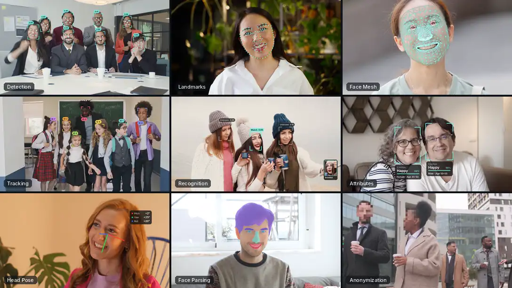
  </picture>
  <br>
  <sub>十五项任务中的九项，同一个库。所有叠加效果均为 UniFace 逐帧输出。</sub>
</div>

<br>

```bash
pip install "uniface[cpu]"          # CPU 和 Apple Silicon
pip install "uniface[gpu]"          # NVIDIA CUDA
pip install --pre "uniface[cpu]"    # 最新预发布版本
```

### 第一个示例脚本

`FaceAnalyzer` 通过一次调用完成检测、对齐和识别。属性模型需要显式启用。

```python
import cv2
from uniface import FaceAnalyzer, FairFace

analyzer = FaceAnalyzer(predictors=[FairFace()])

for face in analyzer.analyze(cv2.imread("photo.jpg")):
    print(face.bbox, face.sex, face.age_group, face.embedding.shape)
```

`bbox`、`confidence`、`landmarks` 和 `embedding` 始终会被赋值。年龄、性别、种族、情绪、质量
和人脸状态保持为 `None`，直到你传入相应的预测模型。

<details>
<summary><b>全部十五项任务及其对应模型</b></summary>

<br>

| 任务 | 模型 |
| --- | --- |
| 人脸检测 | RetinaFace, SCRFD, CenterFace, YOLOv5-Face, YOLOv8-Face, BlazeFace |
| 人脸识别 | AdaFace, ArcFace, EdgeFace, MobileFace, SphereFace |
| 人脸跟踪 | BYTETracker, 视频帧之间保持一致的 ID |
| 人脸关键点 | 2d106det (106), PIPNet (98 / 68), Face Mesh (468 / 478, 3D) |
| 人脸解析 | BiSeNet (19 个类别), XSeg 掩码生成 |
| 人像抠图 | MODNet, PP-Matting (v1 HRNet-W18, v2 STDC1), 无需三分图 |
| 视线估计 | MobileGaze (ResNet-18 / 34 / 50, MobileNetV2) |
| 头部姿态 | 6D 旋转表示，俯仰 / 偏航 / 翻滚 |
| 人口统计属性 | AgeGender, FairFace (年龄组、性别、种族) |
| 情绪 | AffectNet-7 和 AffectNet-8 |
| 人脸状态 | FaceAttribNet: 眼部状态、眼镜、太阳镜、口罩 |
| 人脸质量 | eDifFIQA (T / S / M / L) |
| 人脸防伪 | MiniFASNet 活体检测 |
| 匿名化 | 5 种模糊方法 |
| 向量存储 | 基于 FAISS 的嵌入向量搜索 |

支持 CPU、Apple Silicon 和 CUDA。模型权重在首次使用时下载。

</details>

<br>

### 检测人脸并测量特征

**人脸检测** &nbsp;·&nbsp; [文档](https://yakhyo.github.io/uniface/modules/detection/)

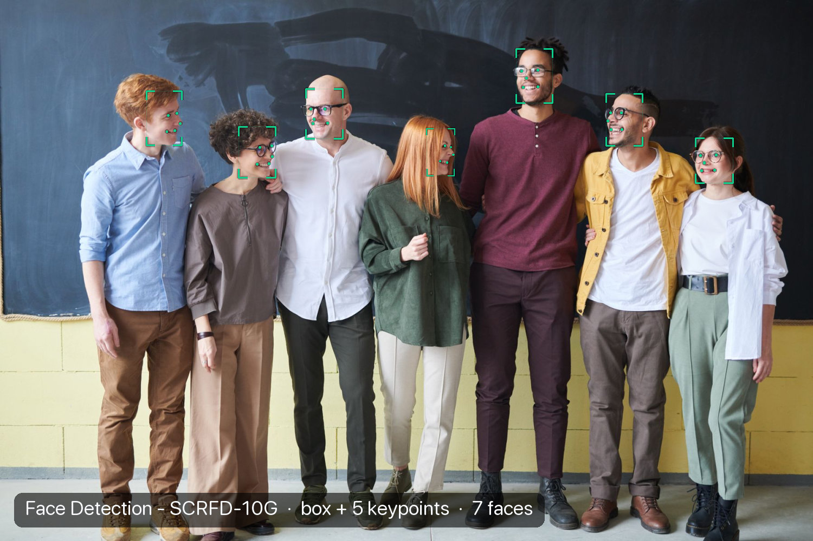

**人脸关键点** &nbsp;·&nbsp; [文档](https://yakhyo.github.io/uniface/modules/landmarks/)

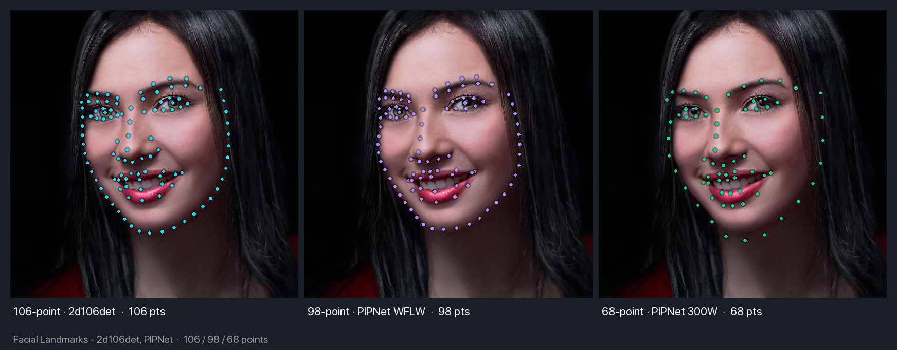

**人脸网格** &nbsp;·&nbsp; [文档](https://yakhyo.github.io/uniface/modules/landmarks/#face-mesh-468-or-478-points-3d)

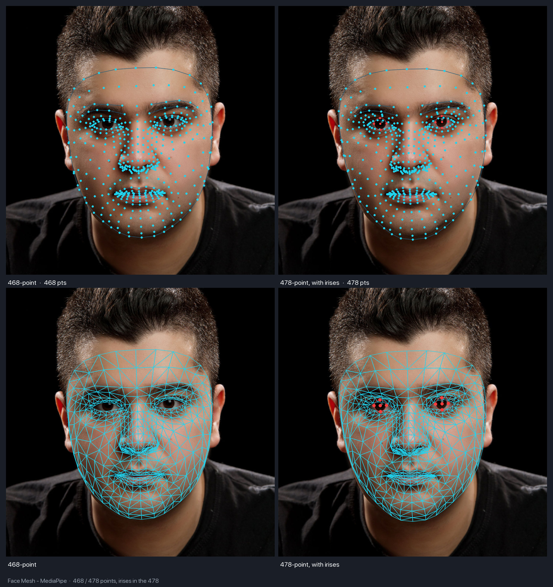

**人脸质量** &nbsp;·&nbsp; [文档](https://yakhyo.github.io/uniface/modules/quality/)

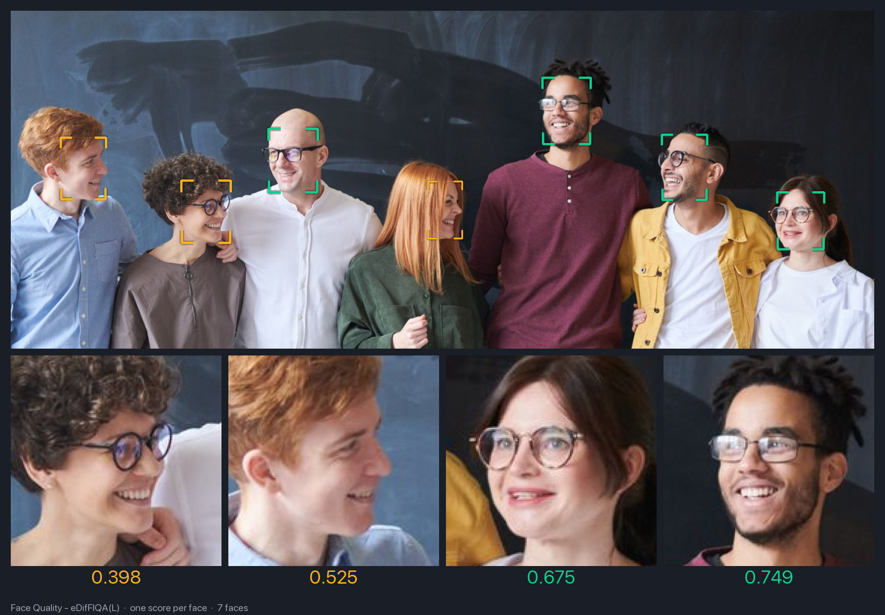

### 分割人脸与人像

**人脸解析** &nbsp;·&nbsp; [文档](https://yakhyo.github.io/uniface/modules/parsing/)

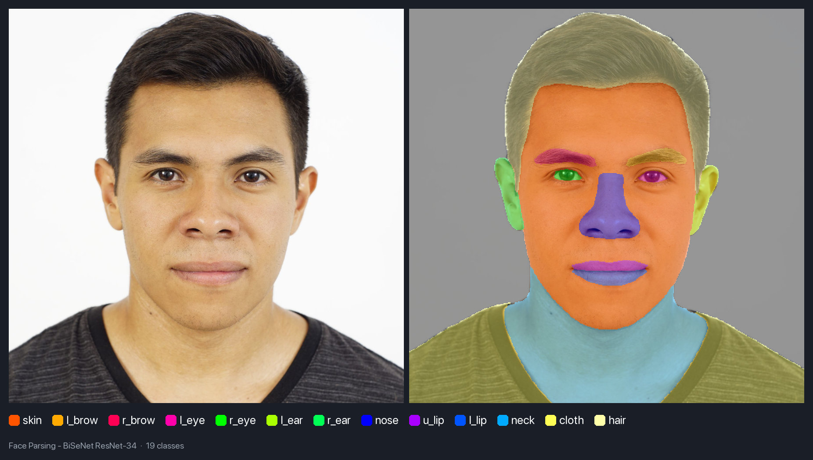

**人脸分割** &nbsp;·&nbsp; [文档](https://yakhyo.github.io/uniface/modules/parsing/#xseg)

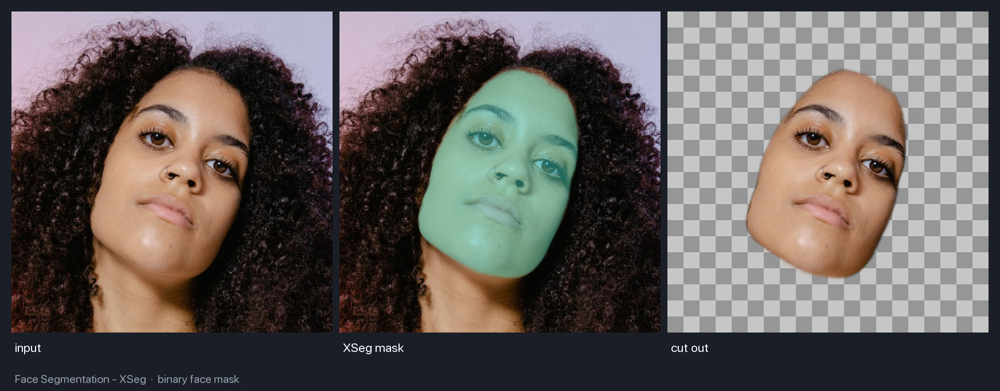

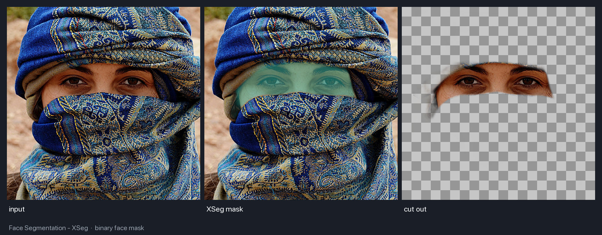

**人像抠图** &nbsp;·&nbsp; [文档](https://yakhyo.github.io/uniface/modules/matting/)

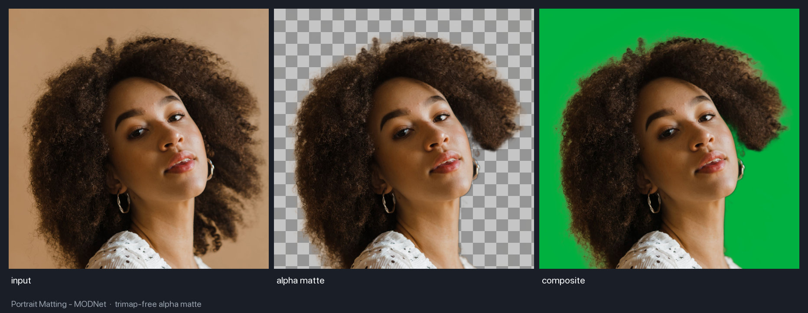

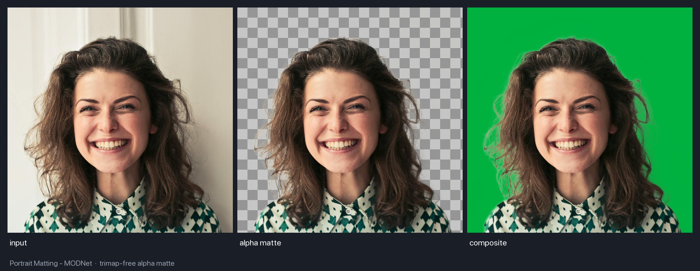

### 估计头部朝向与视线方向

**头部姿态** &nbsp;·&nbsp; [文档](https://yakhyo.github.io/uniface/modules/headpose/)

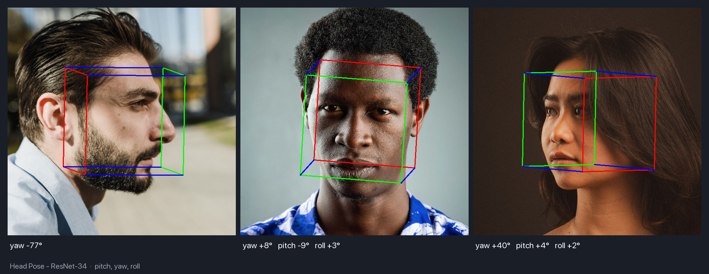

**视线估计** &nbsp;·&nbsp; [文档](https://yakhyo.github.io/uniface/modules/gaze/)

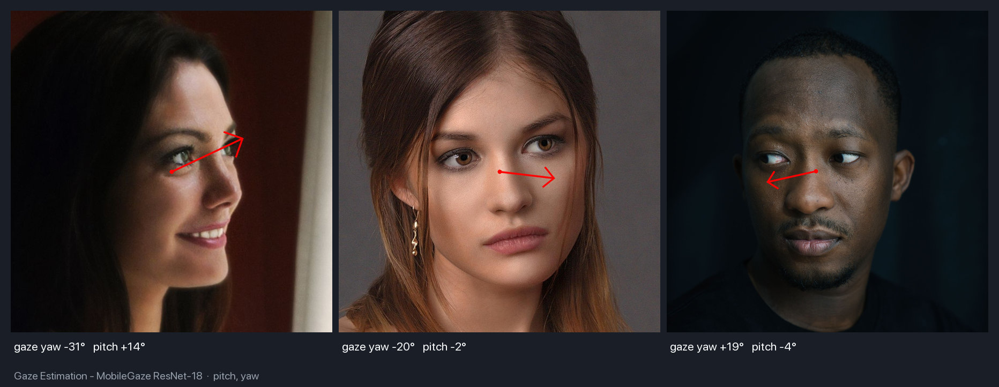

### 分析人脸属性

**年龄与性别** &nbsp;·&nbsp; [文档](https://yakhyo.github.io/uniface/modules/attributes/)

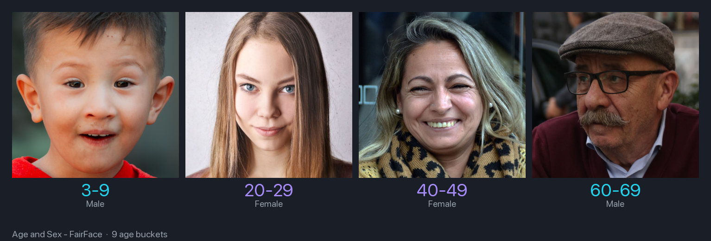

**情绪** &nbsp;·&nbsp; [文档](https://yakhyo.github.io/uniface/modules/attributes/#emotion)

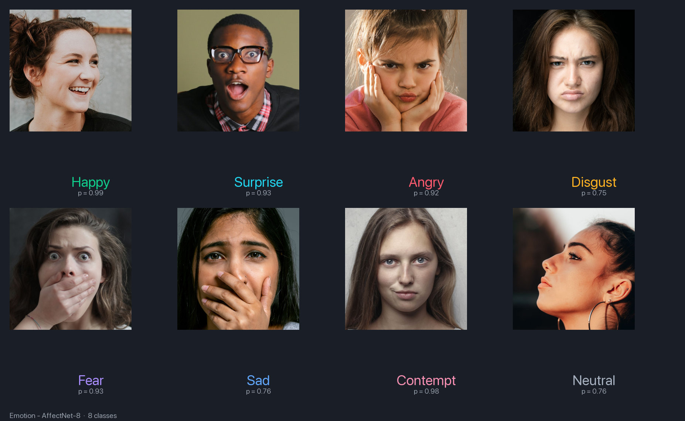

**人脸状态** &nbsp;·&nbsp; [文档](https://yakhyo.github.io/uniface/modules/attributes/#faceattribnet)

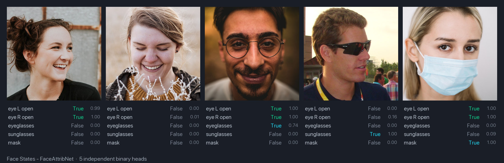

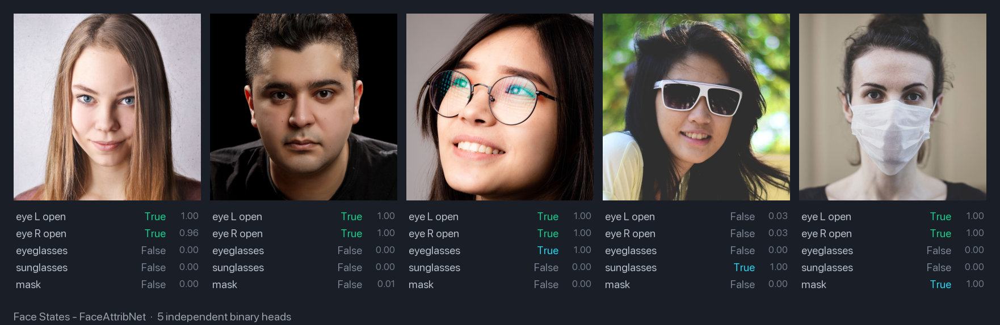

### 区分真实人脸与回放攻击

**人脸防伪** &nbsp;·&nbsp; [文档](https://yakhyo.github.io/uniface/modules/spoofing/)

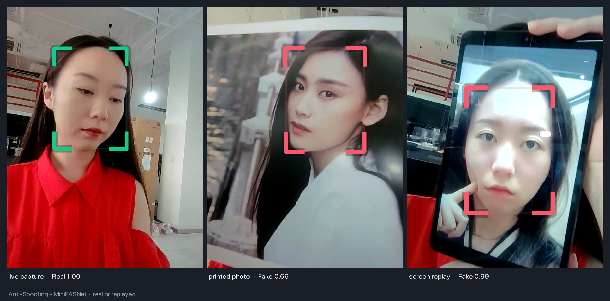

### 匹配人脸或进行匿名化处理

**人脸识别** &nbsp;·&nbsp; [文档](https://yakhyo.github.io/uniface/modules/recognition/)

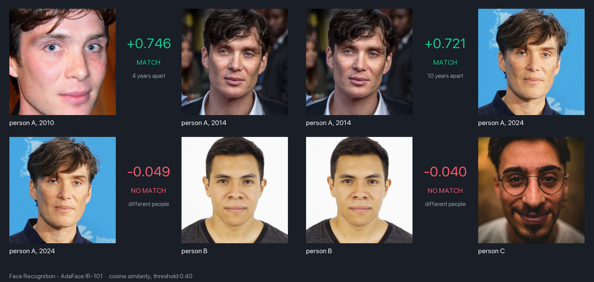

**人脸匿名化** &nbsp;·&nbsp; [文档](https://yakhyo.github.io/uniface/modules/privacy/)

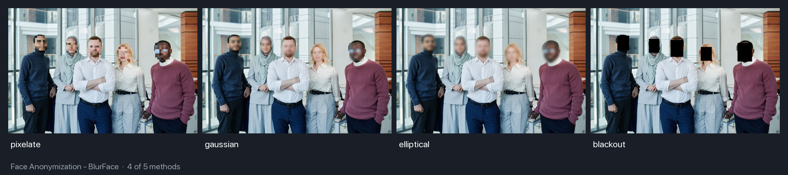

<br>

<div align="center">

[参与贡献](CONTRIBUTING.md) &nbsp;·&nbsp;
[问题反馈](https://github.com/yakhyo/uniface/issues)

UniFace 使用 [MIT](LICENSE) 许可证；部分预训练权重采用其他许可证，因此在商业发布前请查看
[许可证说明](https://yakhyo.github.io/uniface/license-attribution/)。<br>
本项目与 Rocket Software 的 [Uniface](https://uniface.com/) 无关。

</div>
