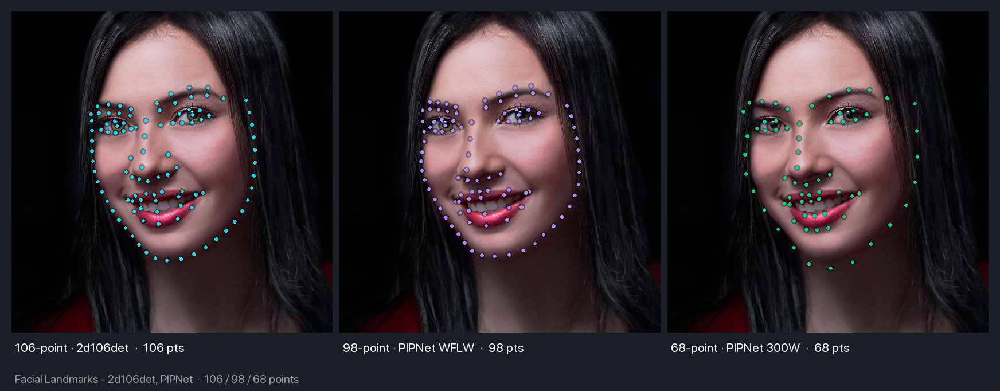
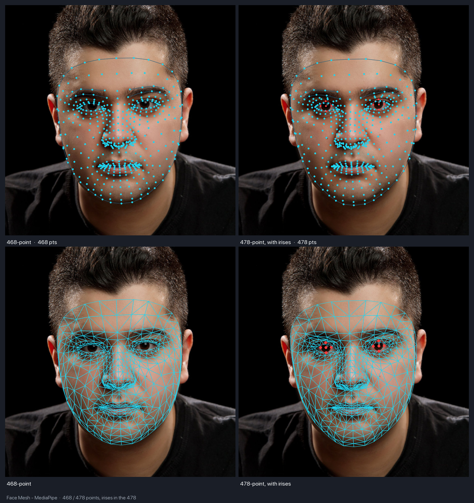

# Landmarks

Facial landmark detection provides precise localization of facial features.

<figure markdown="span">
  { width="100%" }
  <figcaption>106-point (2d106det), 98-point and 68-point (PIPNet) on the same face</figcaption>
</figure>

---

## Available Models

| Model | Points | Size |
|-------|--------|------|
| **Landmark106** | 106 | 4.8 MB |
| **PIPNet (WFLW-98)** | 98 | 47 MB |
| **PIPNet (300W+CelebA-68)** | 68 | 46 MB |
| **FaceMesh** (`V1_468`) | 468 (3D) | 2.4 MB |
| **FaceMesh** (`V2_478`) | 478 (3D, with irises) | 4.6 MB |

!!! info "5-Point Landmarks"
    Basic 5-point landmarks are included with all detection models (RetinaFace, SCRFD, CenterFace, YOLOv5-Face, YOLOv8-Face).
    BlazeFace is the exception — it returns 6 MediaPipe keypoints instead; see [Detection](detection.md#blazeface).

---

## 106-Point Landmarks

### Basic Usage

```python
from uniface.detection import RetinaFace
from uniface.landmark import Landmark106

detector = RetinaFace()
landmarker = Landmark106()

# Detect face
faces = detector.detect(image)

# Get detailed landmarks
if faces:
    landmarks = landmarker.get_landmarks(image, faces[0].bbox)
    print(f"Landmarks shape: {landmarks.shape}")  # (106, 2)
```

### Landmark Groups

| Range | Group | Points |
|-------|-------|--------|
| 0-32 | Face contour | 33 |
| 33-42 | Left eye | 10 |
| 43-51 | Left eyebrow | 9 |
| 52-71 | Mouth | 20 |
| 72-86 | Nose | 15 |
| 87-96 | Right eye | 10 |
| 97-105 | Right eyebrow | 9 |

Left and right are as seen in the image, so the left eye is the one on the left side of the picture.
The contour indices do not run along the jawline in order: point 0 is the chin, and the two sides are
numbered separately. See [Draw with Connections](#draw-with-connections) for the drawing order.

### Extract Specific Features

```python
landmarks = landmarker.get_landmarks(image, face.bbox)

# Face contour
contour = landmarks[0:33]

# Left eye and eyebrow (left side of the image)
left_eye = landmarks[33:43]
left_eyebrow = landmarks[43:52]

# Mouth
mouth = landmarks[52:72]

# Nose (point 86 is the tip)
nose = landmarks[72:87]

# Right eye and eyebrow
right_eye = landmarks[87:97]
right_eyebrow = landmarks[97:106]
```

---

## PIPNet (98 / 68 points)

PIPNet (Pixel-in-Pixel Net) is a high-accuracy facial landmark detector. UniFace ships
two ONNX variants that share a ResNet-18 backbone and 256×256 input — the only difference
is the number of points and the dataset they were trained on.

### Basic Usage

```python
from uniface.detection import RetinaFace
from uniface.landmark import PIPNet

detector = RetinaFace()
landmarker = PIPNet()  # Default: 98 points (WFLW)

faces = detector.detect(image)
if faces:
    landmarks = landmarker.get_landmarks(image, faces[0].bbox)
    print(f"Landmarks shape: {landmarks.shape}")  # (98, 2)
```

### 68-Point Variant (300W+CelebA, GSSL)

```python
from uniface.constants import PIPNetWeights
from uniface.landmark import PIPNet

landmarker = PIPNet(model_name=PIPNetWeights.DW300_CELEBA_68)
landmarks = landmarker.get_landmarks(image, face.bbox)
print(landmarks.shape)  # (68, 2)
```

The 68-point 300W variant places its jaw contour more loosely than the other two, with outline
points that can drift off the silhouette. If you need a tight face boundary, prefer the 98-point
WFLW variant or the 106-point model.

### Notes

- The number of landmarks is read from the ONNX output and the matching meanface
  table is selected automatically — there is no `num_lms=` argument.
- PIPNet uses an asymmetric crop around the bbox (+10% left / right / bottom,
  −10% top) and ImageNet normalization. This is handled internally.
- Output landmarks are in original-image pixel coordinates as `float32`.

---

## Face Mesh (468 or 478 points, 3D)

<figure markdown="span">
  { width="100%" }
  <figcaption>468 beside 478 points, as landmarks above and as the full tessellation below. The 478 variant adds the iris points, in red</figcaption>
</figure>

Google MediaPipe's dense mesh. Unlike the other landmarkers it returns **3D** points
and a face-presence score, and it processes every face in an image in a single batched
inference call.

### Basic Usage

Works with any detector — it needs a bounding box, plus the first two landmarks (the
eyes) to align the crop:

```python
from uniface import SCRFD, FaceMesh

detector, mesher = SCRFD(), FaceMesh()

faces = detector.detect(image)
results = mesher.predict(image, faces)   # one batched call for all faces

results[0].landmarks.shape   # (468, 3) — x, y in image pixels; z is relative depth
results[0].points_2d.shape   # (468, 2) — depth dropped
results[0].score             # face presence, [0, 1]
```

Without a detector, pass boxes directly:

```python
results = mesher.predict(image, bboxes=[[x1, y1, x2, y2]])
```

### Iris landmarks

`V2_478` is MediaPipe's Face Landmarker: the same 468 mesh points in the same order,
plus ten iris points. Everything else — the detector, the ROI, the drawing edges — is
unchanged, so switching is a one-word change.

Following MediaPipe, the result stays a flat array and region membership lives in
named constants:

```python
from uniface import SCRFD, FaceMesh
from uniface.constants import FaceMeshWeights
from uniface.landmark import IRIS_LEFT, IRIS_RIGHT, NUM_MESH_LANDMARKS

mesher = FaceMesh(model_name=FaceMeshWeights.V2_478)
result = mesher.predict(image, SCRFD().detect(image))[0]

result.landmarks.shape                  # (478, 3)
result.landmarks[:NUM_MESH_LANDMARKS]   # the 468 mesh points, as V1_468 returns them
result.landmarks[IRIS_LEFT]             # (5, 3) — center, right, top, left, bottom
result.landmarks[IRIS_RIGHT]            # (5, 3)
# IRIS_LEFT is the iris on the left side of the image, which is the subject's right eye.

left_pupil = result.landmarks[IRIS_LEFT][0, :2]
```

Each iris is ordered center-first, so the mean distance from point 0 to the other four
gives the iris radius. A human iris is close to 11.7 mm across regardless of the
person, which makes that radius usable as a scale reference for real-world distance.

`V2_478` runs at 256×256 against `V1_468`'s 192×192 — 113 against 35 MMac. The
wall-clock gap is narrower than that ratio since neither model saturates a modern CPU,
so benchmark your own target. It is an addition, not a replacement: stay on `V1_468`
unless you need the irises.

### Drop-in Use

`FaceMesh` implements the same interface as `Landmark106` and `PIPNet`, so it can be
swapped into existing code that expects 2D points:

```python
landmarks = mesher.get_landmarks(image, face.bbox)   # (478, 2) for the V2_478 mesher above
```

### MediaPipe Parity

Seeding the mesh with [BlazeFace](detection.md#blazeface) — the detector MediaPipe uses
internally — reproduces MediaPipe's own output:

```python
from uniface import BlazeFace, FaceMesh

detector, mesher = BlazeFace(), FaceMesh()
results = mesher.predict(image, detector.detect(image))
```

### Visualization

```python
from uniface.draw import draw_mesh

draw_mesh(image, results[0].landmarks)                 # 'partial': contours + points
draw_mesh(image, results[0].landmarks, mode='full')    # dense 2556-edge tessellation
draw_mesh(image, results[0].landmarks, mode='points')  # points only
```

!!! tip "Use `partial` or `points` for video"
    `mode='full'` issues 2556 line draws per face. It is the most detailed view but
    noticeably slower — prefer the other two for real-time work.

### Notes

- The crop follows MediaPipe's ROI rule: a square region at 1.5× the detector box,
  rotated so the eye line is horizontal. Tune it with `margin=` if the mesh clips.
- Passing `Face` objects roll-normalizes the crop automatically. With bare `bboxes`
  the crop is axis-aligned, which degrades the mesh on tilted heads.
- `roi_from_box` and `warp_roi` are public, so you can build MediaPipe's video-mode
  ROI tracking (ROI from the previous frame's mesh) on top of the model.
- `score` saturates near 1.0 for anything plausible. It confirms the model ran; it is
  not a discriminative confidence, so do not threshold on it.

---

## 5-Point Landmarks (Detection)

All detection models except BlazeFace provide 5-point landmarks. BlazeFace returns 6
MediaPipe keypoints instead, so its `supports_alignment` is `False`; see
[Detection](detection.md#blazeface).

```python
from uniface.detection import RetinaFace

detector = RetinaFace()
faces = detector.detect(image)

if faces:
    landmarks_5 = faces[0].landmarks
    print(f"Shape: {landmarks_5.shape}")  # (5, 2)

    left_eye = landmarks_5[0]
    right_eye = landmarks_5[1]
    nose = landmarks_5[2]
    left_mouth = landmarks_5[3]
    right_mouth = landmarks_5[4]
```

---

## Visualization

### Draw 106 Landmarks

```python
import cv2

def draw_landmarks(image, landmarks, color=(0, 255, 0), radius=2):
    """Draw landmarks on image."""
    for x, y in landmarks.astype(int):
        cv2.circle(image, (x, y), radius, color, -1)
    return image

# Usage
landmarks = landmarker.get_landmarks(image, face.bbox)
image_with_landmarks = draw_landmarks(image.copy(), landmarks)
cv2.imwrite("landmarks.jpg", image_with_landmarks)
```

### Draw with Connections

```python
import cv2
import numpy as np

# Contour points from one temple, down through the chin (point 0), up to the other temple
CONTOUR = [1, 9, 10, 11, 12, 13, 14, 15, 16, 2, 3, 4, 5, 6, 7, 8, 0,
           24, 23, 22, 21, 20, 19, 18, 32, 31, 30, 29, 28, 27, 26, 25, 17]

def draw_landmarks_with_connections(image, landmarks):
    """Draw the 106 landmarks with the face contour, eye and mouth outlines."""
    points = landmarks.astype(np.int32)

    # Face contour
    cv2.polylines(image, [points[CONTOUR]], False, (255, 255, 0), 1)

    # Outline of each eye (33-42, 87-96) and the mouth (52-71)
    for start, end in ((33, 43), (87, 97), (52, 72)):
        cv2.polylines(image, [cv2.convexHull(points[start:end])], True, (0, 255, 0), 1)

    # Draw points
    for x, y in points:
        cv2.circle(image, (int(x), int(y)), 2, (0, 255, 255), -1)

    return image
```

---

## Use Cases

### Face Alignment

```python
from uniface.face_utils import face_alignment

# Align face using 5-point landmarks
aligned, _ = face_alignment(image, faces[0].landmarks)
# Returns: (112x112 aligned face, inverse transform matrix)
```

### Eye Aspect Ratio (Blink Detection)

```python
import numpy as np

def eye_aspect_ratio(eye_landmarks):
    """Calculate eye aspect ratio for blink detection."""
    # Vertical distances
    v1 = np.linalg.norm(eye_landmarks[1] - eye_landmarks[5])
    v2 = np.linalg.norm(eye_landmarks[2] - eye_landmarks[4])

    # Horizontal distance
    h = np.linalg.norm(eye_landmarks[0] - eye_landmarks[3])

    ear = (v1 + v2) / (2.0 * h)
    return ear

# Usage with 106-point landmarks: corner, two upper-lid points, corner, two lower-lid points
left_eye = landmarks[[35, 41, 42, 39, 37, 36]]
right_eye = landmarks[[89, 95, 96, 93, 91, 90]]
ear = (eye_aspect_ratio(left_eye) + eye_aspect_ratio(right_eye)) / 2

if ear < 0.15:
    print("Eyes closed (blink detected)")
```

On the sample photos an open eye measures about 0.24 to 0.31 and a closed eye about 0.08, so 0.15 is a
starting point. Tune it on your own footage.

### Head Pose Estimation

```python
import cv2
import numpy as np

def estimate_head_pose(landmarks, image_shape):
    """Estimate head pose from facial landmarks."""
    # 3D model points (generic face model)
    model_points = np.array([
        (0.0, 0.0, 0.0),       # Nose tip
        (0.0, -330.0, -65.0),  # Chin
        (-225.0, 170.0, -135.0),  # Left eye corner
        (225.0, 170.0, -135.0),   # Right eye corner
        (-150.0, -150.0, -125.0), # Left mouth corner
        (150.0, -150.0, -125.0)   # Right mouth corner
    ], dtype=np.float64)

    # 2D image points (from 106 landmarks)
    image_points = np.array([
        landmarks[86],   # Nose tip
        landmarks[0],    # Chin
        landmarks[35],   # Left eye outer corner
        landmarks[93],   # Right eye outer corner
        landmarks[52],   # Left mouth corner
        landmarks[61]    # Right mouth corner
    ], dtype=np.float64)

    # Camera matrix
    h, w = image_shape[:2]
    focal_length = w
    center = (w / 2, h / 2)
    camera_matrix = np.array([
        [focal_length, 0, center[0]],
        [0, focal_length, center[1]],
        [0, 0, 1]
    ], dtype=np.float64)

    # Solve PnP
    dist_coeffs = np.zeros((4, 1))
    success, rotation_vector, translation_vector = cv2.solvePnP(
        model_points, image_points, camera_matrix, dist_coeffs
    )

    return rotation_vector, translation_vector
```

---

## Available Landmarkers

```python
from uniface.constants import FaceMeshWeights, PIPNetWeights
from uniface.landmark import FaceMesh, Landmark106, PIPNet

# Default: 106-point InsightFace model
landmarker = Landmark106()

# 98-point PIPNet (WFLW)
landmarker = PIPNet()

# 68-point PIPNet (300W+CelebA)
landmarker = PIPNet(model_name=PIPNetWeights.DW300_CELEBA_68)

# 468-point dense 3D mesh (MediaPipe Face Mesh)
landmarker = FaceMesh()

# 478-point dense 3D mesh with irises (MediaPipe Face Landmarker)
landmarker = FaceMesh(model_name=FaceMeshWeights.V2_478)
```

---

## See Also

- [Detection Module](detection.md) - Face detection with 5-point landmarks
- [Attributes Module](attributes.md) - Age, gender, emotion
- [Gaze Module](gaze.md) - Gaze estimation
- [Concepts: Coordinate Systems](../concepts/coordinate-systems.md) - Landmark formats
- [CLI Tools](https://github.com/yakhyo/uniface/blob/main/tools/README.md) - Command-line scripts for all UniFace modules
