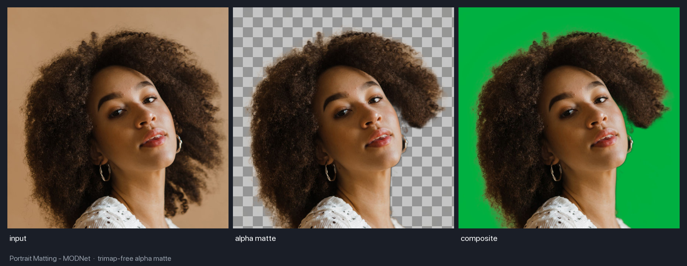
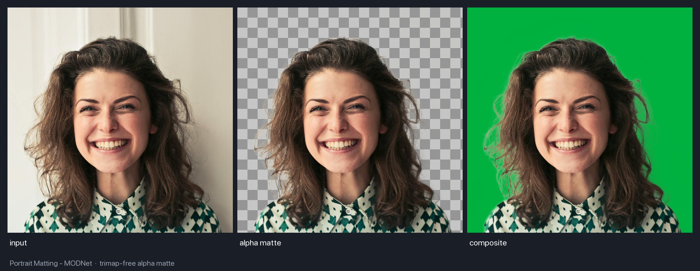

# Portrait Matting

Portrait matting produces a soft alpha matte separating the foreground (person) from the background — no trimap needed.

<figure markdown="span">
  { width="100%" }
  <figcaption>MODNet: Input → Matte → Green Screen</figcaption>
</figure>

---

## Available Models

| Model | Variant | Size | Use Case |
|-------|---------|------|----------|
| **MODNet Photographic** :material-check-circle: | PHOTOGRAPHIC | 25 MB | High-quality portrait photos |
| MODNet Webcam | WEBCAM | 25 MB | Real-time webcam feeds |
| **PP-MattingV2** :material-check-circle: | V2 | 34.2 MB | Default `PPMatting` variant, faster |
| PP-Matting | V1 | 93.8 MB | More accurate, slower |

---

## Basic Usage

```python
import cv2
from uniface.matting import MODNet

matting = MODNet()

image = cv2.imread("photo.jpg")
matte = matting.predict(image)

print(f"Matte shape: {matte.shape}")   # (H, W)
print(f"Matte dtype: {matte.dtype}")   # float32
print(f"Matte range: [{matte.min():.2f}, {matte.max():.2f}]")  # [0, 1]
```

---

## Model Variants

### MODNet

```python
from uniface.matting import MODNet
from uniface.constants import MODNetWeights

# Photographic (default) — best for photos
matting = MODNet()

# Webcam — optimized for real-time
matting = MODNet(model_name=MODNetWeights.WEBCAM)

# Custom input size
matting = MODNet(input_size=256)
```

| Parameter | Default | Description |
|-----------|---------|-------------|
| `model_name` | `PHOTOGRAPHIC` | Model variant to load |
| `input_size` | `512` | Shorter side is resized to this value when it is larger, or when the whole image is smaller; otherwise the image keeps its size |
| `providers` | `None` | ONNX Runtime execution providers |

### PP-Matting

`PPMatting` is a drop-in alternative to `MODNet` with the same `predict()` call and the same `(H, W)` float32
matte in `[0, 1]`.

```python
from uniface.matting import PPMatting
from uniface.constants import PPMattingWeights

# PP-MattingV2 with STDC1 (default): faster
matting = PPMatting()

# PP-Matting with HRNet-W18: more accurate, slower
matting = PPMatting(model_name=PPMattingWeights.V1)
```

| Parameter | Default | Description |
|-----------|---------|-------------|
| `model_name` | `V2` | Model variant to load |
| `max_short` | `512` | Upper bound on the shorter side; smaller images are never upscaled |
| `providers` | `None` | ONNX Runtime execution providers |

Both sides are floored to a multiple of 32 before inference, and the matte is resized back to the input size.
On macOS, the auto-selected CoreML execution provider can make the HRNet-W18 matte differ from the CPU provider.
The mean difference is small, but a few thousand pixels can differ by any amount up to the full `[0, 1]` range, so
pass `providers=['CPUExecutionProvider']` for stable results. PP-MattingV2 agrees between the two to within 0.01.

---

## Applications

### Transparent Background (RGBA)

```python
import cv2
import numpy as np

matting = MODNet()
image = cv2.imread("photo.jpg")
matte = matting.predict(image)

rgba = cv2.cvtColor(image, cv2.COLOR_BGR2BGRA)
rgba[:, :, 3] = (matte * 255).astype(np.uint8)
cv2.imwrite("transparent.png", rgba)
```

### Green Screen

```python
import numpy as np

matte_3ch = matte[:, :, np.newaxis]
bg = np.full_like(image, (0, 177, 64), dtype=np.uint8)
green = (image * matte_3ch + bg * (1 - matte_3ch)).astype(np.uint8)
cv2.imwrite("green_screen.jpg", green)
```

<figure markdown="span">
  { width="100%" }
  <figcaption>A plain, low-contrast background: individual flyaway strands survive into the composite</figcaption>
</figure>

MODNet is trimap-free, so a background that competes with the subject in sharpness and contrast
is where the alpha edge softens. Compositing onto a blurred or plain background hides most of it;
if you need a clean cut, shoot against a plain wall.

### Custom Background

```python
import cv2
import numpy as np

background = cv2.imread("beach.jpg")
background = cv2.resize(background, (image.shape[1], image.shape[0]))

matte_3ch = matte[:, :, np.newaxis]
result = (image * matte_3ch + background * (1 - matte_3ch)).astype(np.uint8)
cv2.imwrite("custom_bg.jpg", result)
```

### Webcam Matting

```python
import cv2
import numpy as np
from uniface.matting import MODNet
from uniface.constants import MODNetWeights

matting = MODNet(model_name=MODNetWeights.WEBCAM)
cap = cv2.VideoCapture(0)

while True:
    ret, frame = cap.read()
    if not ret:
        break

    matte = matting.predict(frame)
    matte_3ch = matte[:, :, np.newaxis]
    bg = np.full_like(frame, (0, 177, 64), dtype=np.uint8)
    result = (frame * matte_3ch + bg * (1 - matte_3ch)).astype(np.uint8)

    cv2.imshow("Matting", np.hstack([frame, result]))
    if cv2.waitKey(1) & 0xFF == ord("q"):
        break

cap.release()
cv2.destroyAllWindows()
```

---

## Available Matting Models

```python
from uniface.constants import MODNetWeights, PPMattingWeights
from uniface.matting import MODNet, PPMatting

# Default (Photographic)
matting = MODNet()

# Webcam variant
matting = MODNet(model_name=MODNetWeights.WEBCAM)

# PP-MattingV2 with STDC1 (default PPMatting variant)
matting = PPMatting()

# PP-Matting with HRNet-W18
matting = PPMatting(model_name=PPMattingWeights.V1)
```

---

## Next Steps

- [Parsing](parsing.md) - Face semantic segmentation
- [Privacy](privacy.md) - Face anonymization
- [Detection](detection.md) - Face detection
- [CLI Tools](https://github.com/yakhyo/uniface/blob/main/tools/README.md) - Command-line scripts for all UniFace modules
